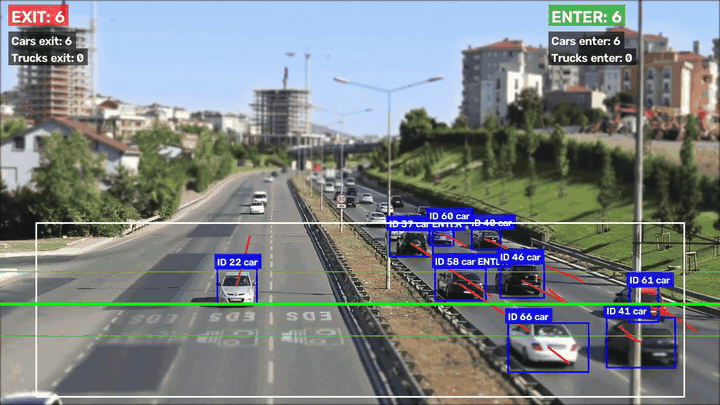

# Traffic Vehicle Detection, Tracking and Counting

Detects cars and trucks in traffic video with YOLOv8, follows each vehicle across frames with ByteTrack, and counts it once when it crosses a virtual line, by direction (ENTER/EXIT) and class. Outputs an annotated video, a bar chart, a JSON summary and a PDF report. Built at Deggendorf Institute of Technology (Campus Cham) under the supervision of Prof. Dr. Sunil Survaiya.

[](https://colab.research.google.com/github/akhileshsuresh97/traffic-vehicle-counting/blob/main/demo.ipynb)

**Try it in your browser:** the Colab notebook installs the project, downloads a free sample traffic clip and shows the annotated result, about 2–3 minutes with Runtime → Run all. You can also upload your own video there.

<!-- demo GIF goes here:  -->

## How it works

```
video frame → YOLOv8 (cars, trucks) → ByteTrack (track IDs) → truck–trailer merge
            → ROI + box-area filter → class vote → line crossing → counts + annotated frame
```

Detection alone isn't enough to count reliably, so most of the work is in the steps after it:

- **Tracking:** ByteTrack gives each vehicle a persistent ID, so a vehicle visible for 100 frames is still one vehicle. Each ID is counted at most once per direction.
- **Direction counting:** a vehicle whose centroid moves from below the line to above it counts as ENTER; from above to below, EXIT. A tolerance band around the line ignores large jumps caused by tracking noise.
- **Truck–trailer merging:** YOLOv8 often detects a tractor and its trailer as two overlapping trucks. Overlapping truck boxes (IoU ≥ 0.1) are merged, keeping the larger one.
- **Class voting:** labels can flicker between car and truck from frame to frame. The class used for counting is the majority over the last 15 frames.
- **Region of interest and area filter:** only vehicles in the lower part of the frame, with plausible box sizes, are counted. This removes distant, partial and spurious detections.

## Run it

```bash
git clone https://github.com/akhileshsuresh97/traffic-vehicle-counting.git
cd traffic-vehicle-counting
python -m venv .venv
source .venv/bin/activate        # Windows: .venv\Scripts\activate
pip install -r requirements.txt

python count_vehicles.py your_traffic_video.mp4 --show
```

The YOLOv8 weights download automatically on first run. The default `yolov8l.pt` is the model used in the project; on a laptop without a GPU, `--model yolov8n.pt` is much faster.

Outputs go to `output/`: `annotated.mp4`, `vehicle_counts.png`, `vehicle_count_report.pdf` and `counts.json`.

Useful options:

| Option | Default | What it does |
|---|---|---|
| `--model` | `yolov8l.pt` | YOLOv8 weights: `n`, `s`, `m`, `l` or `x` |
| `--conf` | `0.5` | detection confidence threshold |
| `--line` | `0.88` | counting line height as a fraction of the frame |
| `--roi-top` | `0.55` | top of the counting zone as a fraction of the frame |
| `--max-seconds` | all | only process the first N seconds |
| `--show` | off | show frames while processing (press q to stop) |

The line and ROI need to suit the camera view. The defaults fit a camera looking along a road, with vehicles large and clearly visible in the lower part of the frame.

### Web demo

`python app.py` starts the same Gradio app that runs on Hugging Face Spaces.

### Make a GIF of the result

```bash
python make_gif.py output/annotated.mp4 docs/demo.gif --start 2 --duration 6
```

## Tests

```bash
python -m unittest discover tests
```

The tests cover the counting rules without needing YOLOv8: IoU, truck–trailer merging, ENTER/EXIT direction, counting once despite jitter on the line, ROI, area and class filters, and class voting. An end-to-end test runs the full pipeline on a synthetic video with simulated vehicles and checks the counts, the H.264 output video, the chart and the PDF.

## Project structure

```
count_vehicles.py   Command-line tool
app.py              Gradio web demo
pipeline.py         YOLOv8 + ByteTrack, drawing, video in/out
counting.py         Counting logic (detector-independent, fully tested)
report.py           Bar chart and PDF report
make_gif.py         GIF from the annotated video
demo.ipynb          Colab demo notebook
tests/              Unit and end-to-end tests
```

## Limitations

- No accuracy figures: the project wasn't evaluated against hand-counted ground truth, so there is no measured counting accuracy.
- Only cars and trucks are counted. Buses and motorcycles are ignored.
- The line and ROI are set by hand for each camera view.
- Vehicles that stay hidden behind others while crossing the line can be missed.

## What changed from the original version

The original was a single script. This version splits it into tested modules, adds a command-line interface and a web demo, and fixes one issue: the original called `model.track()` without choosing a tracker, which makes Ultralytics use its default, BoT-SORT, although the project describes ByteTrack. It now passes `tracker="bytetrack.yaml"`. The counting rules are the same as in the original.

## My role

Team project with Dhanya Narayan, Mullapudi Rajyalakshmi and Mohammed Danish Fayaz. I wrote the core Python implementation: the YOLOv8 detection pipeline, the ByteTrack integration, truck–trailer merging and false-positive reduction, the video and PDF outputs, and the overall integration. Teammates worked on the tracking and counting logic, visualisation, testing, the ROI design, the literature review and the documentation.

## Built with

Python, Ultralytics YOLOv8, ByteTrack, OpenCV, NumPy, Matplotlib, Gradio

Sample video in the Colab demo: [Traffic on a freeway](https://mixkit.co/free-stock-video/traffic-on-a-freeway-99/), Mixkit (Mixkit License).
